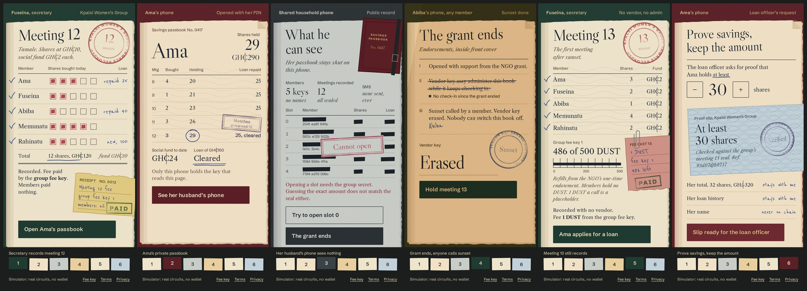

# Undying Ledger

**The savings-group book that can’t be switched off when the grant ends.**

Undying Ledger is a private record book for village savings and loan associations (VSLAs, also called susu groups or savings groups), built on [Midnight](https://midnight.network). It keeps working after the NGO grant and the app vendor are gone. Members hold no crypto and pay nothing. Their balances are hidden from outsiders, including a spouse who shares the household phone.

**How it pays for itself.** Every fee is paid in DUST from one fee key per group. When the grant ends, the NGO registers NIGHT to that key once. The NIGHT keeps generating DUST for the group's meetings, and the NGO keeps the NIGHT. No other chain we looked at lets a fee key be handed to every member safely (see [Why Midnight](#why-midnight)).

Built for the AKINDO Midnight Buildathon, Wave 2.

## Ran on Midnight Preprod (12 October 2026)

A member's call was paid by the **group fee key**: the wallet that signed `recordMeeting`, `attestSavings` and `sunset` held **0 DUST before and after**; the fee-key relay added the fee and submitted. Every hash below opens on the explorer.

| Step | Transaction | Block |
|---|---|---|
| Deploy the group contract [`726bb6e0…ed7c61`](https://preprod.midnightexplorer.com/contracts/726bb6e0ce9d67ecc5c587a2f5f509ae39c26dbfd29d71c75f8d7de090ed7c61) | [`e95e3769…f3bef5`](https://preprod.midnightexplorer.com/transactions/e95e3769116b1868e16cd61cca434e00513c264a966383573466b77561f3bef5) | 2,949,765 |
| `recordMeeting`, fee from the group fee key | [`abbb61e7…1becc5`](https://preprod.midnightexplorer.com/transactions/abbb61e7d1557627f3a2d655c46beee4999315817eeb517d5959db03e31becc5) | 2,950,140 |
| `attestSavings` (“at least N shares”), fee from the group fee key | [`c40214ef…06e320`](https://preprod.midnightexplorer.com/transactions/c40214efed2fdd2869c789166b3dd575a5140fee9e09d55af7f720ec7406e320) | 2,950,145 |
| `sunset` by a member after the 300 s grace: the vendor key is erased | [`76cadb73…3fd0f9`](https://preprod.midnightexplorer.com/transactions/76cadb73800ccc27b7e8f2f1df02a499008566559445c7e2f1162f653e3fd0f9) | 2,950,326 |
| `recordMeeting` **after sunset**, no vendor key left | [`ec0e88f8…57c99a`](https://preprod.midnightexplorer.com/transactions/ec0e88f8c2326b95f326e22ec04286af3ab46ba9302e585cefae2d4d7157c99a) | 2,950,410 |
| `attestSavings` after sunset | [`288b0711…d6fc55`](https://preprod.midnightexplorer.com/transactions/288b07118a38ad6567ccd70d7e34eb116520302253484b92abd3979190d6fc55) | 2,950,415 |

- **Fee:** 1 SPECK per call (10⁻¹⁵ DUST) as the indexer and the explorer report it. The fee key spent 1,001 SPECK per call: the fee plus the wallet SDK's fixed 1,000 SPECK overhead.
- **Proofs:** 2.9 to 3.9 s (`recordMeeting`) and 3.0 to 3.8 s (`attestSavings`) on the local proof server 8.1.0; about 25 to 30 s from submit to final.
- **The endowment:** the deployer sent 2,500 tNIGHT to an NGO key, which registered it to the group fee key's DUST address (`register-dust endow`); the key had DUST within minutes.
- **What did not run:** the member side here was a Node wallet-SDK script, not Lace. Lace with `payFees: false` is still untested (see Known limits).



**Try it live:** https://nice-bills.github.io/undying-ledger/ (or serve `docs/` with any static server: `npx serve docs`). The demo runs the **real compiled Compact circuits** in your browser through `@midnight-ntwrk/compact-runtime`. It needs no wallet, no network and no tokens. **Launch video (50 s, sound optional):** [`media/launch-wide.mp4`](media/launch-wide.mp4) (1920x1080) and [`media/launch-tall.mp4`](media/launch-tall.mp4) (1080x1920), rendered from the real built app by `media/launch/make.sh`, with original music synthesized on a 120 BPM grid and sound effects taken from the app's own animation events. An 84-second recording of the built app is in [`media/demo.mp4`](media/demo.mp4); [`media/demo-narrated.mp4`](media/demo-narrated.mp4) is the same cut with a synthetic voice-over and English captions ([`media/demo.srt`](media/demo.srt)).

---

## The problem, with evidence

1. **The app is free while the NGO contract lasts. After that, the group pays or loses it.**
   - hiveonline’s VSLA.online FAQ: use of the app is "included as part of the initial roll-out package swapping to a subscription fee at the end of the contract… $10/month" per group. https://www.hivenetwork.online/faqs
2. **Use collapses when donor money stops.**
   - Jamii.one (Kenya) digitised 708 groups (24,042 members). "Three months after donor funding ended, only about 15% of those groups were still recording meetings." https://dsghub.org/can-digitalisation-interventions-in-savings-groups-survive-after-the-project-ends/
   - To be fair, Jamii.one mainly blames the end of stipends for field promoters, not server costs. Undying removes the running cost and the dependence on the vendor. It does not fix the incentives for the people involved.
3. **Women often save in secret, and digital records have already exposed them.**
   - From the PCI / Global Communities DreamSave study in Tanzania: when savings SMS went to a shared household phone, "these women did not anticipate their husbands’ receiving their savings information… the husband received an SMS telling him that the notifications had been turned off and he became angry. It is common for women to save privately, away from their husbands." https://globalcommunities.org/wp-content/uploads/2025/09/PCI_Digitizing_Savings_Groups_Report_Tz_Sept_2020.pdf
4. **A plain public chain would be worse than paper.** On a transparent chain, every member’s deposits and missed payments would be readable forever.

## Why Midnight

| Need | What Midnight gives |
|---|---|
| Someone must pay every fee, forever, for members who hold no tokens. The NGO wants to stop paying. | Fees are paid in **DUST**, which is *generated* by NIGHT and **cannot be transferred**. The NGO registers NIGHT once to a per-group DUST address. Its last act is an **endowment, not a subscription**, and it keeps its NIGHT. Relatives abroad can **point their own NIGHT’s DUST** at the same address without sending any money. |
| The fee key must live inside every member’s app. | A copied DUST key can only pay fees. It cannot move NIGHT or any value, and it cannot write to the book, because every circuit checks a role secret. |
| Balances must be hidden from spouses, vendors and explorers, yet still checkable by the group. | Compact circuits keep amounts as private inputs. The chain stores only **hiding commitments**, and the compiler rejects any undisclosed leak. |
| The book must outlive the vendor. | `sunset()` can be called by anyone once the maintainer’s heartbeats stop. It permanently closes the admin paths, and recording continues. |

Other chains fall short. Celo fee abstraction still needs the user to hold cUSD, and every record is public. An Ethereum paymaster deposit gets spent down, and a published gas key is drained within seconds. Aztec and Aleo have private state, but their fees are consumed rather than regenerated, so there is no fee key that is safe to share.

## The demo, in six beats

The UI is built on the object every VSLA already trusts: the **cash box** with three padlocks, each key held by a different member. Each member's shares are coins she taps in; when the meeting is recorded the coins drop through the lid, the lid shuts and the padlocks click closed one by one. Ama's own padlock springs open on her phone; on her husband's phone every lock rattles and stays shut; at sunset the vendor's red padlock falls off the box. Emerald and saffron, huge condensed numbers, and every animation follows a real circuit result or tap. Every figure on screen comes from `DemoEngine` running the compiled circuits; nothing is hard-coded.

| # | Beat | What actually runs |
|---|---|---|
| 1 | **Fuseina records meeting 12** | `recordMeeting` re-commits all 5 passbooks; every member’s phone checks its stamp against the new commitment. The coins go into the box, it locks, the seal lands, and the receipt says the group fee key paid and members paid nothing. |
| 2 | **Ama’s book** | Her padlock opens; meeting 12 slides in: 26 → 29 shares (GH¢290), her GH¢150 loan is cleared, and the stamp is verified against the on-chain commitment with the group secret. A share-out card counts the meetings left in the cycle; **Lock now** hides the screen on a shared phone. |
| 3 | **Her husband’s phone** | Only public state: 5 member keys, 12 meetings, one sealed commitment per slot, no SMS. “Try to open slot 0” runs the stamp check with a guessed group secret and the exact figures, and fails. |
| 4 | **The grant ends** | The vendor’s heartbeats stop and the screen moves toward dusk only as the contract’s grace clock runs down. Calling `sunset()` early is refused by the contract (“The maintainer is still sending heartbeats”). After the grace period, any member calls it; the vendor key is erased and its padlock falls off the box. |
| 5 | **Meeting 13 still records** | `recordMeeting` with no vendor and no admin key; the fee-key tank drains by exactly the fee. |
| 6 | **Prove savings, keep the amount** | `attestSavings` proves “at least 30 shares” for a loan officer; the note rises out of the box’s slot. Asking for 33 when she holds 32 is refused by the circuit, and the note drops back in. |

Also in the app: a **fee key page** (a relative points their NIGHT’s DUST at the key, a leaked key burns DUST but cannot write the book, time refills it, rotation starts a fresh key), **Terms** and **Privacy** pages, and a **live page** for a group deployed on Preprod (`#/live`): anyone can read its public register, and with Lace a member can join it by address and act on it (record a meeting, open their own passbook, prove at least N shares, call sunset). The live write path is wired and unit-tested with a mocked Lace, but has not been run against Preprod yet (see Known limits).

The simulator makes no zero-knowledge proofs, so the proving skeletons stay up for a short fixed time and say so. Once real proof times are measured on Preprod they appear in those notes (see [PREPROD.md](PREPROD.md)).

## Architecture

```
contract/   undying.compact (8 circuits, Compact 0.31.1) + witnesses + a no-wallet simulator + 20 unit tests
ui/         React 19 + Vite. src/demo: DemoEngine (simulator), fee-key model, measured.ts
            src/beats: the six beats; src/box: the cash box art and motion; src/pages: fee key, Terms, Privacy
            src/lace: the Preprod live page: public register, then Lace write-through (LiveSession,
            LiveWrite). Lazy-loaded: the demo never ships Midnight.js; the write path loads after Lace connects
chain/      Preprod wiring: Midnight.js 4.1.1 deploy/join/call, Lace connect/check/providers (payFees:false),
            the group fee-key relay, deploy and measure scripts. Preprod via Blockfrost.
e2e/        TesterArmy e2e suite: the six-beat story, the refusals and #/live without Lace, at 390x844 and 430x932
docs/       the static build of ui/ for GitHub Pages (relative paths)
media/      demo.mp4, demo-narrated.mp4 + demo.srt, six screenshots, live/ (joined-group screens from the dev preview), record-demo.mjs
scripts/    preprod.sh: one command from clone to a measured Preprod deployment
```

```
 member phone (Ama)             secretary phone (Fuseina)            anyone
 ───────────────────            ─────────────────────────            ──────
 private state:                 private state:                       public ledger:
  her key, group secret,         her key, group secret,               member keys, meeting count,
  her own passbook               every passbook                       one commitment per slot,
        │                              │                              heartbeat time, phase,
        │ attestSavings(≥N)            │ recordMeeting(page, 5 entries) fee-key epoch, attestations
        ▼                              ▼                                     ▲
   local proof server ──proof──▶ Midnight (Preprod) ◀──fee in DUST── group fee-key relay
   (localhost:6300)                     │                         (one shared DUST key per group,
                                        └─ sunset(): anyone, after the grace period
```

### The contract (`contract/src/undying.compact`)

The contract was compiled with **Compact toolchain 0.31.1** (`pragma language_version 0.23`) against **compact-runtime 0.16.0**. These are the versions the Preprod and Mainnet support matrix lists. Toolchains 0.34 and 0.35 target ledger 9, which is not live yet.

| Circuit | Who | What it does | k (rows) |
|---|---|---|---|
| `constructor` | NGO / vendor | Creates the group: up to 10 member keys, secretary, maintainer, group-secret tag, first fee-key tag, grace period. Pre-commits all 10 passbooks to zero. | n/a |
| `recordMeeting(page, entries[5])` | secretary | For each of 5 slots: opens the old passbook commitment, applies the entry (shares, social fund, loan issued, loan repaid; no over-repayment allowed) and writes a fresh commitment. **Every slot is re-committed every meeting**, so the chain can’t tell who saved or borrowed. | 14 (11,288) |
| `attestSavings(slot, min, nonce)` | member | Proves "I hold ≥ `min` shares" for a loan officer’s nonce without revealing the amount. | 14 (12,771) |
| `addMember(key)` | secretary | Adds a member (max 10). Works after sunset. | 13 |
| `handoverSecretary(key)` | secretary | Hands the role to a new secretary. Works after sunset. | 13 |
| `adminReplaceSecretary(key)` | maintainer | Replaces a lost secretary. **Disabled after sunset.** | 13 |
| `heartbeat(now)` | maintainer | Proves the maintainer is alive. `now` can’t be in the future (checked with `blockTimeGte`). **Disabled after sunset.** | 13 |
| `sunset()` | **anyone** | Allowed once `lastHeartbeat + grace` has passed. Sets the phase to SUNSET and erases the maintainer key. | 7 |
| `rotateFeeKey(tag)` | secretary | Records the tag of a fresh group DUST key, so member apps switch keys. Works after sunset. | 13 |

The `k` values come from `zkir mock-compile` on the compiled output. All circuits are at k ≤ 14. The first version used `persistentCommit` (SHA-256), which made `recordMeeting` k=17 with 94k rows. Moving the passbook commitments to Poseidon-based `transientCommit` cut it to about one eighth of that. The trade-off is that Compact does not promise transient hashes stay stable across language versions, so a future contract upgrade would have to re-commit the passbooks. Identity keys still use `persistentHash`.

**How a member gets her balance without a server.** At the meeting, the secretary’s phone hands each member’s phone a *stamp*: the plaintext passbook plus its version. The member’s app checks the stamp against the on-chain commitment using the group secret. A secretary who lies is caught immediately, and a secretary whose phone holds a tampered book cannot record at all, because the circuit re-opens every old commitment. This works like stamping a paper passbook, with no operator database.

### Privacy model

| | Who can see it |
|---|---|
| Amounts (shares, social fund, loans), names, all secrets | **Never on-chain.** Amounts are private circuit inputs and leave the device only inside a hiding commitment. |
| Each member’s own passbook | That member’s phone (PIN-locked app). The app sends no SMS. |
| Every passbook | The secretary’s phone. Shares are counted aloud at a real VSLA meeting too, so the group already knows them. |
| Group size, slot numbers, number of meetings, commitments, heartbeat time, sunset phase, fee-key epoch/tag, "≥ N shares" attestations (by slot) | Public. |

Two known leaks are accepted:
- An attestation reveals which slot (a pseudonym) made it.
- The group size is public.

The unit tests check the raw public state. They search the ledger and every public transcript for the exact amounts recorded and for every secret, and they show that two groups with very different balances produce public state of the same shape.

### The group fee key ("Group Commons")

- There is **one DUST key per group**, not one global public key, and it is kept inside the members’ app. If the key were public to the whole world, anyone could drain the regenerating DUST at no cost to themselves (see the risks below).
- **The NGO endows the key once** by registering NIGHT for DUST generation to the key’s DUST address. Relatives can add capacity by **designating** their NIGHT’s DUST to the same address.
- **Anyone in the group can run the relay** (`chain/src/relay/fee-key-relay.ts`). It starts a DUST wallet from the group key with `DustWallet(...).startWithSecretKey(...)`, adds the DUST fee to a member’s bound transaction (`balanceFinalizedTransaction(tx, …, { tokenKindsToBalance: ['dust'] })`, the same flow as `sponsorAndSubmit` in example-private-party) and submits it. It refuses anything that is not a call to this group’s contract.
- **Members sign with Lace** in `payFees: false` mode (`chain/src/browser.ts`, copied from example-bboard), or with a burner wallet. Either way they hold 0 DUST.

## Run it

Requires Node 22+.

```bash
npm ci
npm test                      # 20 contract tests + 2 demo-story tests + 28 live-wiring tests (vitest)
npm run typecheck             # contract, ui, chain
npm run dev                   # the demo at http://localhost:5173
                              # http://localhost:5173/#/live?fake=1 previews the joined live screens with a made-up
                              # session (dev only; the production build drops it). Nothing reaches Preprod.
npm run build                 # static build -> ui/dist, copied to docs/
npm run test:e2e              # e2e suite against docs/ (cd e2e && npm ci first; see e2e/README.md)
```

Recompile the contract. Proving keys are not committed; `compact compile` regenerates them:

```bash
curl --proto '=https' --tlsv1.2 -LsSf https://github.com/midnightntwrk/compact/releases/latest/download/compact-installer.sh | sh
compact update 0.31.1         # pin it: 0.34/0.35 target ledger 9, which is not live
npm run compact               # -> contract/src/managed/undying (contract/, zkir/, keys/)
```

### Tests

| Suite | Count | What |
|---|---|---|
| `contract/src/test/undying.test.ts` | 20 | every circuit, every refusal, raw public state searched for amounts and secrets, two groups with different balances have identically shaped public state |
| `ui/src/demo/__tests__/engine.test.ts` | 2 | the demo story end to end on the engine; a leaked key drains fees (by overpaying) but not the book, rotation recovers |
| `ui/src/lace/__tests__/live-session.test.ts` | 28 | the Lace write path with a mocked `window.midnight` (dApp connector 4.0.1) and mocked Midnight.js providers: connect, network and prover checks, join by address, record meeting through the fee-key relay (`payFees: false`) or with Lace paying, own passbook and stamps checked with the real `passbookCommitment`, proof, sunset, and every error message |
| `e2e/tests/live.e2e.ts` | 1 per phone size | `#/live` loads from the static build, shows the recorded Preprod run with no wallet or token, says there is no Lace wallet; no write controls without one |
| Preprod, by hand (12 Oct 2026) | 6 transactions | `scripts/preprod.sh` and `chain/src/scripts/*`: register-dust, deploy, endow, relay, `measure --apply`; hashes in [Ran on Midnight Preprod](#ran-on-midnight-preprod-12-october-2026) |
| `e2e/tests/demo-flow.e2e.ts` | 4 per phone size | the six-beat story in a real browser, the refusals, Terms/Privacy/fee key, no console errors; plus an agentic smoke test that runs only with a model key |

### Deploying the demo

`docs/` is the built app with relative paths. GitHub Pages serves the `gh-pages` branch, and `.github/workflows/pages.yml` force-pushes `docs/` to it (`git subtree split --prefix docs`) whenever `docs/` changes on `main`. Live at https://nice-bills.github.io/undying-ledger/.

### Preprod

See **[PREPROD.md](PREPROD.md)** and `scripts/preprod.sh`: Docker proof server, Lace and the faucet, DUST registration, deploy, connecting the UI, and measuring the real fee and proof times (`measure --apply` writes them into the UI; done on 12 Oct 2026). Preprod’s indexer and RPC moved to Blockfrost on 9 October 2026 and now need a project token.

## Roadmap (Wave 3)

1. **Groups of 30.** Six pages of five slots, matching the 15 to 30 members of a real VSLA.
2. **Secretary recovery after sunset.** Today only the maintainer can replace a lost secretary, and sunset removes the maintainer. Members will be able to replace her by vote.
3. **A standby fee key and a share-out circuit** for the end of the savings cycle.
4. **A burner key inside the member app**, so a member needs no wallet at all and the relay adds the fee.
5. **One pilot group.** The measure of success is whether the group is still recording six months after the NGO leaves.

## Known limits

- **What ran on Preprod, and what has only been tested with mocks.** On Preprod (12 Oct 2026, see the table at the top): DUST registration, the deploy, the NGO endowment, the fee-key relay, and `recordMeeting`, `attestSavings` and `sunset` signed by a 0-DUST caller and paid by the relay, all from Node with the wallet SDK. **Not run on a network:** the browser write path on `#/live` (Lace connect, `payFees: false`, Lace's transaction into the relay, browser private state). It is covered by unit tests with a mocked Lace and mocked providers, which prove the wiring and the error paths, not that Lace behaves like the mock. Open questions:
  - Does Lace honour `balanceUnsealedTransaction(tx, { payFees: false })`? The API type has it; wallet behaviour is unconfirmed. If Lace refuses, the page says “Lace would not balance this call without paying the fee itself (payFees: false)” and offers to let Lace pay from the member’s own DUST. If Lace accepts but still adds its own fee, the relay now refuses the call rather than add a second fee (written, not yet run).
  - Will the relay accept what Lace returns? `balanceUnsealedTransaction` gives back a finalized transaction and the relay re-balances it with `balanceFinalizedTransaction` for DUST only. That pairing has not been exercised.
  - Does `levelPrivateStateProvider` (IndexedDB through `browser-level`) work in the Vite build in a real browser? It is bundled and typechecked; it was never opened in a browser here.
  - Answered on Preprod: a fresh wallet syncs about 1.65 million DUST events from genesis in roughly 1 h 45 min (CPU-bound, one core), so `chain/src/wallet-state.ts` saves and restores synced state (a restore takes about 6.5 min) and `npm run sync-wallets -w chain` syncs the wallets ahead of time. Real proofs took 3.8 to 3.9 s.
  - Can a browser call Blockfrost directly with a pasted token (CORS)? Untested with a valid token.
- **The fee is measured on Preprod, not Mainnet.** On Preprod a call costs 1 SPECK (the key spends 1,001 SPECK with the SDK overhead). At that rate the 5 DUST cap of a single NIGHT would cover about five trillion calls, so the endowment's real cost is the NIGHT the NGO locks, not the fees. Mainnet fee parameters may differ; the pitch line against VSLA.online's US$10 a month should be re-checked there. Cap (5 DUST per NIGHT) and refill (about a week) follow the published parameters.
- **The six beats drive the simulator; Preprod writes live on `#/live`.** The live page joins a deployed group by address with the member’s secrets (from `.preprod/group.json`; in a real group they arrive by QR) and calls the real circuits through `chain/src/api.ts`: `recordMeeting` (secretary), `attestSavings` (member), `sunset` (anyone). A member’s passbook stays in browser private state, encrypted with a passphrase; after each meeting the secretary hands out one-line stamps, which the member’s phone checks against the sealed commitment before keeping. The beats themselves are not wired to Preprod, and the private state written by the Node deploy script does not carry over to the browser, so a secretary who wants to record on an older group must import the stamps first.
- **Fee-drain risk.** Anyone holding the group key can spend its DUST on junk transactions. At 1 SPECK a call, draining by count is impractical, but a junk transaction can overpay its fee, so a copied key can still empty the balance. That is a denial of service, not a theft. Mitigations: one key per group kept inside the members’ app, a relay that sponsors only this group’s circuits, an endowment split across several NIGHT UTXOs (relays sharing a key can hit `DustDoubleSpend`, error 196, and must retry), and early rotation (a new key starts at zero DUST).
- **The guarantee is social, not locked.** The NGO can revoke its DUST registration at any time, and the protocol reserves the right to change DUST rules.
- **No contract upgrade path at sunset.** Handing maintenance authority to the group at sunset is future work.
- **Time, not blocks.** The heartbeat window is in seconds of block time (90 s in the demo, 7 days by default on deploy).
- **Up to 10 members per contract**, recorded as 2 pages of 5. Real VSLAs have 15 to 30 members.
- **Transient commitments.** Passbooks use Poseidon `transientCommit` (k=14 instead of 17), which Compact does not promise to keep stable across language versions; a future upgrade would re-commit the passbooks.
- **Design:** prices are written GH¢, as in Ghanaian shops and markets (the faces have no ₵ glyph); screen readers hear ₵.

## Attribution

Apache-2.0. This project adapts code and patterns from two official Midnight examples. Both are Apache-2.0, Copyright (C) Midnight Foundation, and each adapted file says what was taken:

- [midnightntwrk/example-bboard](https://github.com/midnightntwrk/example-bboard): the simulator test pattern, the witness layout, the Lace dApp-connector providers and the Vite WASM configuration.
- [midnightntwrk/example-private-party](https://github.com/midnightntwrk/example-private-party): the DUST sponsorship flow and service, `wallet.ts` and `config.ts`.

See `NOTICE`.
